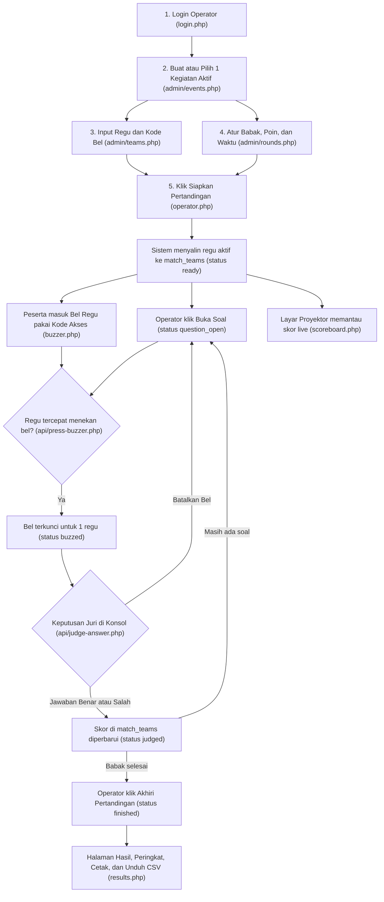

# CCI An Nuur

Aplikasi cerdas cermat berbasis PHP native, MySQL, HTML, CSS, dan JavaScript vanilla untuk mengelola bel digital peserta, papan skor layar musholla, serta konsol juri dan operator.

## Kebutuhan

- PHP 8.1 atau lebih baru dengan ekstensi `pdo_mysql`
- MySQL 8 atau MariaDB 10.6 atau lebih baru
- Browser modern

## Instalasi dan Menjalankan Aplikasi

1. Impor struktur database beserta akun demo awal menggunakan file `schema.sql` di root proyek (file ini otomatis membuat database `cerdas_cermat` beserta seluruh tabelnya).

   ```bash
   mysql -u root -p < schema.sql
   ```

   Jika database `cerdas_cermat` sudah dibuat sebelumnya, kamu juga bisa mengimpor `database/schema.sql` langsung ke database tersebut.

2. Sesuaikan konfigurasi database di file `.env` (salin dari `.env.example` jika belum ada) agar cocok dengan host, port, nama database, user, dan password MySQL lokalmu.

3. Jalankan server PHP bawaan langsung dari root folder proyek.

   ```bash
   php -S 127.0.0.1:8080
   ```

   Hindari menjalankan aplikasi dari dalam subfolder seperti `localhost/Cerdas-Cermat` tanpa konfigurasi VirtualHost karena tautan aset dan navigasi memakai path dari root (`/operator.php`, `/assets/css/app.css`).

4. Buka `http://127.0.0.1:8080` di browser untuk halaman utama, atau `http://127.0.0.1:8080/login.php` untuk masuk ke konsol operator.

### Akun awal operator

- Username `admin`
- Password `admin123`

Ganti password akun bawaan sebelum aplikasi dipakai di lingkungan produksi atau acara resmi.

## Diagram Alur Aplikasi



## Penjelasan Alur Penggunaan

### 1. Persiapan oleh Panitia

Panitia masuk melalui `login.php`, lalu membuka `admin/events.php` untuk membuat atau memilih satu kegiatan yang aktif. Setelah kegiatan dipilih, panitia melengkapi dua data utama sebelum lomba dimulai.

- Daftar regu beserta kode akses bel (3 sampai 12 huruf atau angka) diinput melalui `admin/teams.php`. Minimal harus ada dua regu aktif.
- Daftar babak beserta aturan nilai benar, nilai salah, dan durasi waktu menjawab diatur melalui `admin/rounds.php`.

Setelah regu dan babak lengkap, panitia membuka `operator.php`, memilih babak yang dimainkan, lalu menekan tombol **Siapkan pertandingan**. Pada tahap ini sistem membuat data pertandingan baru di tabel `matches` dengan status `ready` dan menyalin semua regu aktif saat itu ke tabel `match_teams` dengan skor awal `0`.

### 2. Pelaksanaan Pertandingan di Tiga Layar

Selama pertandingan berlangsung, sistem dipakai secara bersamaan pada tiga tampilan berbeda.

- Konsol operator (`operator.php`) dipakai panitia atau juri dari laptop untuk membuka soal, menilai jawaban, membatalkan bel, atau membatalkan nilai terakhir (`api/undo-score.php`).
- Halaman bel peserta (`buzzer.php`) dibuka dari HP masing-masing regu dengan memasukkan ID Pertandingan (jika diminta) dan kode akses regu yang sudah terdaftar di `match_teams`.
- Layar skor musholla (`scoreboard.php`) ditampilkan di layar utama musholla untuk memperlihatkan peringkat skor langsung, nama regu yang mendapat hak jawab, serta hitung mundur waktu menjawab.

Siklus untuk setiap soal berjalan berulang dengan urutan berikut.

1. Operator menekan **Buka soal** (`api/open-question.php`). Nomor soal bertambah, status pertandingan berubah menjadi `question_open`, dan tombol bel di HP seluruh peserta menjadi aktif.
2. Peserta tercepat yang menekan bel melalui `api/press-buzzer.php` langsung mengunci status pertandingan menjadi `buzzed`. Tekanan bel dari regu lain setelahnya otomatis ditolak.
3. Juri memberi keputusan melalui `api/judge-answer.php`. Jika dipilih **Jawaban benar** atau **Jawaban salah**, skor regu di `match_teams` langsung bertambah atau berkurang sesuai aturan babak, riwayat nilai dicatat ke `score_events`, dan status berubah menjadi `judged` agar operator bisa membuka soal berikutnya. Jika terjadi salah pencet bel, operator bisa memilih **Batalkan bel** supaya soal yang sama kembali ke status `question_open`.

### 3. Penutupan dan Rekap Hasil

Jika seluruh soal dalam babak telah selesai, operator menekan **Akhiri pertandingan** (`api/finish-match.php`). Status pertandingan berubah menjadi `finished`, tombol bel peserta tidak lagi aktif, dan operator langsung diarahkan ke halaman `results.php`.

Di halaman `results.php`, panitia dapat melihat peringkat akhir, memeriksa riwayat keputusan nilai, mencetak rekapitulasi hasil, atau mengunduh data dalam format CSV lewat `export-results.php`. Pertandingan yang berstatus `finished` juga otomatis muncul pada bagian arsip pemenang di halaman utama `index.php`.

## Catatan Operasional Penting

1. Pastikan seluruh regu sudah selesai diinput dan berstatus aktif di `admin/teams.php` sebelum menekan **Siapkan pertandingan** di `operator.php`. Regu yang ditambahkan setelah pertandingan telanjur dibuat tidak otomatis masuk ke `match_teams` pada pertandingan yang sedang berjalan. Jika ada regu susulan, akhiri pertandingan berjalan terlebih dahulu lalu siapkan pertandingan baru.
2. Pastikan hanya satu kegiatan yang berstatus aktif di `admin/events.php` selama perlombaan berlangsung agar deteksi pertandingan otomatis pada halaman bel peserta (`buzzer.php`) dan layar skor musholla (`scoreboard.php`) tidak tertukar dengan kegiatan lain.
